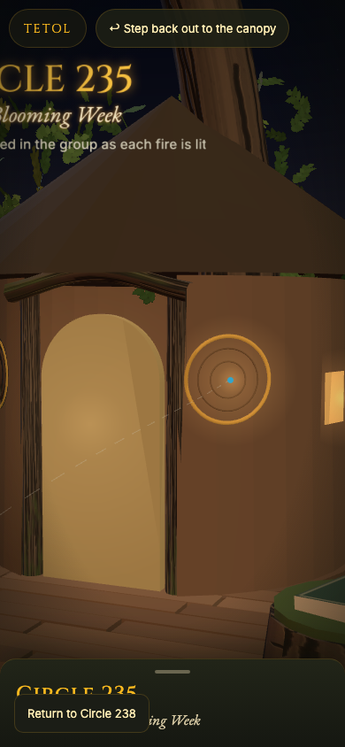
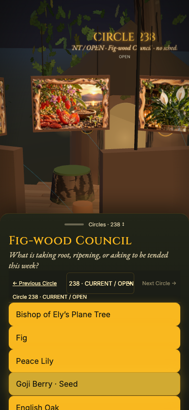

# Council Time Tree — provisional review candidate, 26 October 2026

Human review only. No merge, deployment, Publish, DNS or backend action is authorised by this receipt. Atlas #123 / PR #124 is separate.

## Diagnosis and evidence boundaries

Two attached iPhone screenshots (not three) show the 2D Circle 238 invitation and an immersive Circle 235 sign/panel with a Return to Circle 238 control. Neither exposes the browser address. Their exact device URL/cache contents cannot be recovered from the images.

A fresh live entry from the 2D Canopy was observed to preserve `/tetol/circle-235/pre-fire/tetol.html?circle=238#croom` and load the 238 title, approved question, panel and ten companion buttons. The directory is the shared renderer package, not the selected edition. GitHub main and the connected editor both identify `4b00112206296d66d465557480d10283575b19bb` at investigation time; that alone is not deployment proof.

**Confirmed source/runtime fault:** the `c233now` hotspot unconditionally selected drawing slot 233. That slot actually contains edition **235**. Reproduction on the current-main TETOL changes `D.council.active` from 238 to 233, `D.council.current` from `c238` to `c233`, and paints Circle 235 while retaining `circle=238` and the 238 return control. The legacy `c233` doorway also retained a Circle 235 panel. This establishes a reproducible cause of the observed class of mismatch, not proof of which precise tap happened on the user's phone.

**Confirmed mobile interaction fault:** pointer-up on the grab opens the sheet, moving a companion button under the finger before the compatibility click. Instrumentation observed pointerdown/up on `BUTTON#grab`, followed by a click on a different button. That activated an unintended companion and collapsed the sheet. Adapter fallback listeners also competed with shared grab handling. The guard is gesture-based rather than timed, so slow rendering cannot let a delayed compatibility click through. An early loader handler runs before the legacy window-capture learning handlers. Loader/runtime readiness is checked so mixed versions fail unavailable. One shared handler now owns the gesture and consumes only its trusted browser follow-up click (not programmatic navigation); the next pointerdown or keydown restores normal actions.

**Confirmed 2D return fault:** the global map-filter provider unconditionally synchronised query parameters on Council pages. React Router’s `setSearchParams` discarded historical fragments such as `#previous-circle-235`, resetting the edition selector to 238. Council routes now retain ownership of their URL; filter state still resumes on Atlas. The existing auth-route guard is unchanged.

**Legacy embed:** `CouncilOfLifePage` still embeds the archived 235 card intentionally. It now supplies `circle=235` explicitly. Its “Return to Circle 235” and `previous-circle-235` focus restoration remain scoped to that historical embed, rather than being repurposed as the current doorway. Weekly 237/238 links use their own explicit edition query.

**Live HTTP verification:** the loader, entry, 238 adapter, manifest and all ten approved scene assets returned HTTP 200 and matched main exactly. The served HTML is not byte-identical to raw Git source; its response hash is recorded without attributing that difference to a cause. The actual fresh browser entry nonetheless selected 238 correctly. See `LIVE-HTTP.json`.

**Cache investigation:** the existing service-worker configuration excludes the TETOL package from precache and app-shell navigation fallback. Council JSON/art may still be revision-cached by the app worker. The approved 237/238 JSON/art bytes are unchanged by this patch. The changed entry module receives a release query from the loader. The original iPhone HTTP cache, old tabs/BFCache and its service-worker state remain uninspected; no claim is made that clearing caches alone fixes this bug. Review must verify the actual candidate asset versions after any separately approved publication.

## Before / after screenshots

Both images below are local Chromium reproductions at 390×844, with reduced motion. They are not native iPhone acceptance evidence. The before run used the exact main loader, entry and 238 adapter; the after run used the candidate. No supplied phone metadata or profile image was uploaded.

| Main reproduction: 235 sign/panel with Return 238 | Candidate: 238 and the Time Tree |
|---|---|
|  |  |

`REPRODUCTION.json` records the actual engine slots, real edition, room, panel, sign canvas text and visible frame group. It also records successful existing Circle 233, records chest, Staff Room and return-to-current checks.

## Change scope

- One public edition index and equivalent accessible 2D / original TETOL navigators.
- Explicit Previous / Next / selector / current-return links using real edition queries. Edition changes leave historical iframes into the full original Tree, keeping the outer page from showing another edition.
- Resolve legacy current hotspots within the selected edition; old “previous” hotspot follows the immediately preceding edition.
- Reuse the original 234 forms already retained in the engine; no replacement renderer or new artwork.
- Circle 236 keeps its unapproved question null; the legacy 235 question is not carried into its presentation.
- Historical presentation for 234–236, PREVIOUS for 237 and CURRENT / OPEN for 238. Frozen historical OPEN values remain untouched.
- Browser history entries for internal journeys, popstate restoration, canonical legacy deep links, honest unavailable state on failed edition loading.
- The old automatic 235 welcome invitation is hidden by the edition presentation; its original record is preserved.
- Shared mobile grab handler with a visible “Circles” affordance; controls stay in the existing sheet, not over the art.
- No changes to Supabase, Auth, RLS, functions, stored research, images, historical registries, current question, roster, Fire or Atlas identity.

## Route / navigation matrix

Every immersive route starts `/tetol/circle-235/pre-fire/tetol.html`.

| Edition | Presentation | Query / default hash | 2D destination | Previous / next | Existing material |
|---|---|---|---|---|---|
| 238 | CURRENT / OPEN | `?circle=238#croom` | `/council/238` | 237 / none | 10 approved companions, 10 Fig-wood scenes; question retained; Fire null |
| 237 | PREVIOUS | `?circle=237#croom` | `/council/237` | 236 / 238 | 10 companions and 10 already-cleared scene JPEGs; earlier seven-scene/three-hold receipt retained as history |
| 236 | HISTORICAL (OPEN at the time) | `?circle=236#croom` | `/review/council/236` | 235 / 237 | 7 supplied portraits / symbolic forms; existing Birch and Ely pathways |
| 235 | HISTORICAL | `?circle=235#croom` | `/council-of-life#previous-circle-235` | 234 / 236 | 6 original non-human forms and existing learning doorways; no new portraits |
| 234 | HISTORICAL | `?circle=234#croom` | `/council-of-life#historical-circle-234` | none / 235 | 6 original non-human forms including Noku; People are not fabricated attendees |

No-query TETOL remains historical 235 for compatibility. Companion deep links retain their original IDs after `#`; Staff Room is `#staff` in every edition. Older `mem231`, records chest, lineage and Staff Room remain in the original engine; the new selector begins at 234 because that is the scope of this release. No 234 photographic set or deeper companion research is fabricated. Available historical learning studies retain their existing limitations.

## CI budget and merge overlap

The browser job retains all checks and raises its wall-clock budget from 12 to 20 minutes for cold Playwright/OS installation plus the expanded original-Tree journey. The same timeout increase is already proposed in the separate Atlas PR #124; reconcile that identical hunk once when merging. No tests, security gates, backend or deployment steps are removed or added.

## Acceptance and human gates

Automated: `npm run lint`, `npm run typecheck`, `npm run test`, `npm run build`, `npm run security:check`, `node scripts/check-council-public-bytes.mjs`, then `npx playwright test --config playwright.time-tree.config.ts`.

The browser suite checks the sign's actual canvas paint text, selected engine edition and sole visible companion group, phone touch on the sheet and a companion in each edition, legacy-ring regression, companion refresh and Back/Forward, Staff Room, the complete 238→234→238 sequence, 2D entry/selector at 320 and 1440, and failed-manifest handling. Existing suites additionally cover all ten current 237/238 encounters and artwork meshes. The current-main 237 registry explicitly records ten user-cleared artistic scenes; the older seven-scene/three-hold receipt is an archived checkpoint, not the current roster. No private full card or newly cleared image is introduced by this patch. Software rendering is paced and paused only after the first real scene/touch path where stated in tests. It is not proof of native iPhone GPU, camera motion or Safari behaviour.

**Native iPhone Safari: UNVERIFIED.** On the reviewed candidate origin, record the commit/build ID, iOS/Safari version and exact URL. Then:

1. Enter from the 2D 238 Canopy; confirm `?circle=238#croom`, sign 238, panel 238, question and ten matching Fig-wood scenes.
2. Tap “Circles” once: the sheet opens without entering a companion. Exercise Previous 237→236→235→234 and Next back to 238; confirm visible labels and query every time.
3. Enter and return from a companion in every edition. Check all ten 237/238 hangings, and retain archival withheld-image fallback behavior. No image substitution.
4. Refresh an encounter deep link; use Safari Back/Forward within encounters and between editions. Return controls must land in the correct 2D section.
5. Test portrait/landscape, one-thumb reach, selector, VoiceOver focus, camera pan/pinch and motion on/off. No accidental selections under the sheet.
6. Visit Staff Room and older Circle records, return to the same edition, and deliberately return to current 238.
7. Repeat from an existing Safari tab/PWA and a fresh tab. Verify the updated entry module and unchanged manifest/art hashes. If versions disagree, stop publication review rather than substitute another edition.

GO for review only when the recorded tests are green at the exact PR commit. NO-GO for publication until native Safari and human review are complete. Rights/PDF approval, real-origin authentication, frontend recovery and older family-image containment remain separate conditions. No new Fire, attendee, offering or invitation is asserted.
