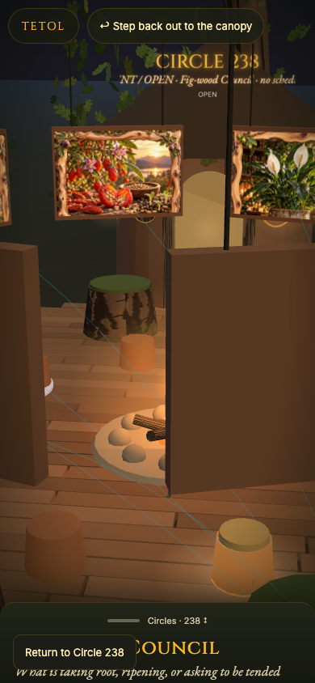
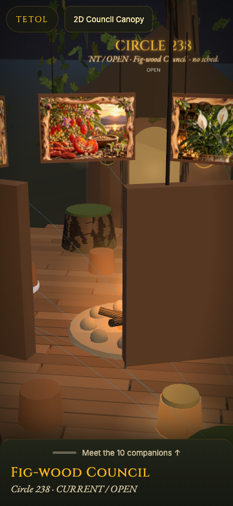
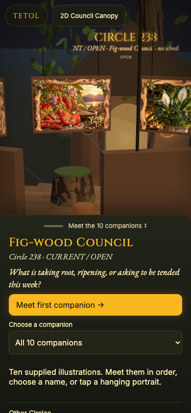
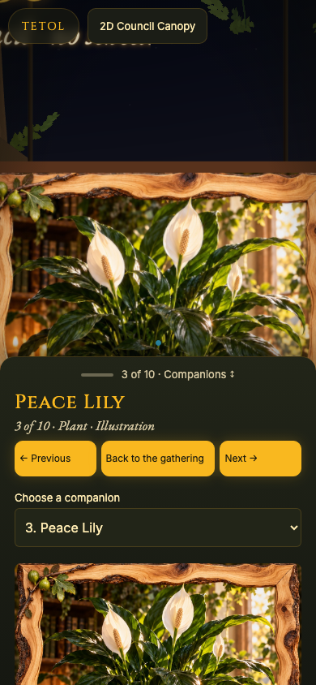

# Meeting Circle 238 companions — provisional review

Issue: https://github.com/S33D-life/ancient-roots-map/issues/126

Baseline: newly merged main `e2f2830f0af383f14d7f0165cd3eb9be4ec9d057` (PR #125). This is a post-release navigation enhancement, not a rollback. Exact candidate SHA and final check results belong in the draft PR receipt. No merge or publication is authorised by this document.

## Three small approaches

| Approach | Mobile journey | Strength | Cost / risk |
|---|---|---|---|
| **Guided meeting + ordered choice — recommended** | Meet the 10 companions → first companion → Previous / Next → Back to the gathering; jump directly by name | One obvious next action; preserves manifest order and native accessibility; no new camera gesture | A small presentation adapter and existing navigation hooks |
| Portrait chooser | Open a ten-thumbnail index → choose a portrait → return to index | Strong visual recognition; quick arbitrary selection | More image choices and scrolling in the sheet; duplicates the hangings above |
| Swipe sequence | Enter one companion → swipe between ten scenes | Compact and familiar | Competes with pan/rotate gestures, is less discoverable and still needs button/list alternatives |

The first approach is implemented as a draft. The count means position in the approved order, **not attendance, visits or a completion record**. The last selected identity exists only in page memory; nothing is stored or shared.

## Captured flow and findings

Captures are local Chromium at 390×844 with reduced motion, using the actual merged renderer and supplied illustrations. They are not native iPhone screenshots. Ed's phone screenshot is not redistributed. The in-app browser's size override retained desktop dimensions, so the accepted mobile evidence comes from the requested browser tests against the pinned local build.

1. **Gathering / peek — improved.** The baseline fixed “Return to Circle 238” covered the title and question; “Circles” suggested edition navigation rather than meeting beings. The candidate gives the existing handle a 44px “Meet the 10 companions” invitation, a readable OPEN status, and one labelled **2D Council Canopy** exit beside TETOL. The approved question appears in full after opening the invitation.
2. **Expanded invitation — improved.** The baseline placed edition controls before ten equally prominent name buttons. The candidate leads with the approved question, “Meet first companion,” and a native ordered chooser. **Other Circles** remains a separate Time Tree section below the companion invitation.
3. **Companion — improved.** The baseline collapsed the panel again and offered no adjacent-companion route. The candidate keeps it open, shows name/category/position and “Illustration,” and offers Previous / Next / Back to the gathering before the artwork and accuracy note. The sequence stops at both ends. Real portrait taps still select the matching original scene.
4. **Returns and history — retained.** Returning to the gathering restores the selected chooser and focus. Keyboard Next/Previous retain useful focus; direct hashes, refresh and browser Back/Forward use the shared engine. “Explore the Tree” preserves the original 3D Canopy journey; the single 2D exit retains its edition query and return anchor.

### 390px screenshots

| Merged gathering | Proposed gathering |
|---|---|
|  |  |

| Proposed expanded invitation | Companion 3 of 10 |
|---|---|
|  |  |

## Narrow implementation

- A Circle 238 presentation module reads the existing manifest projection; it creates no alternate gallery, routes, records or art.
- The existing 238 adapter delegates panel presentation. Small optional hooks in the shared UI keep the sheet open, restore focus and handle the native chooser before WebGL is available. Other editions do not install those hooks.
- Only within the current Council/companion context, the original in-world exit is replaced visually by one explicit 2D exit. Its original 3D destination remains the separately named “Explore the Tree” action. Staff Room and other Tree contexts retain their existing exit presentation.
- The loader's existing gesture guard is unchanged; its entry cache tag and the changed 238 module imports are versioned for this candidate.
- Native select height is explicit (48px), because WebKit ignored its initial minimum height. Its text is 16px; all companion navigation buttons are at least 44px. No swipe gesture is added.

`PRESERVATION.txt` pins the unchanged public Council material, original HTML/classic runtimes, historical adapters and Time Tree. The complete original 3D rendering section is byte-identical to the merged baseline. Circle 238's approved question, roster, manifest, artwork, Fire null and unverified Plane Atlas ID null remain unchanged. No Supabase, Auth, RLS, backend, DNS, dependency or billing change is included.

## Tests and review limits

Reproduce the release gate with `npm ci` and `npm run release-check`, then `node scripts/check-council-public-bytes.mjs`. Remove generated local MCP index drift; it is not part of this frontend PR.

Run current navigation in both engines:

```sh
npx playwright test --config playwright.time-tree.config.ts e2e/council-companion-navigation.spec.ts
```

The suite covers 320, 390 and 430px portrait widths, 844×390 landscape, desktop, the real grab tap without a ghost selection, all ten in order, bounded previous/next, native chooser, keyboard focus, refresh, Back/Forward, 2D return destination, original mesh hit-testing and UI operation before the rendering layer. Existing Time Tree / 237 / 238 tests remain required. CI software-renderer drawing is bounded after the initial real scene/touch; it is not proof of physical iPhone graphics or native picker behaviour.

Unit checks cover canonical order, boundaries, exact image/accuracy references, selector focus, unrelated-room isolation and escaping. Final results and any failed initial runs are recorded in the review receipt; do not infer green checks merely from this checklist.

## Native iPhone acceptance — UNVERIFIED for this draft

On a protected candidate preview, record the exact build, iOS/Safari version and URL. Then:

1. At 320–430px, open the invitation with one thumb. No companion opens under the releasing finger; question and status are readable.
2. Meet all ten using Next and Previous; verify distinct Seed/Fruit identities, supplied illustration and accuracy note. No new attendance, offering or Fire claim appears.
3. Tap a visible hanging scene; confirm matching name, category, position and open panel. Pan/pinch still work; no new swipe interception.
4. Use the native chooser, VoiceOver, hardware keyboard, reduced motion, landscape and Safari safe areas. Confirm 44px targets, no zoom/obscured controls and useful focus return.
5. Refresh a companion deep link, use Safari Back/Forward, return to the gathering, then take the single 2D Canopy exit. Check its edition query/anchor and repeat from an existing tab/PWA.
6. Visit Other Circles, 237–234, older records and Staff Room; return to current 238. Confirm unchanged question, art and Fire state.

Human review is required before merging and separately before publication. No Lovable AI, Publish, hosted deployment, automatic sharing or production switch was performed. The known older hosted family-image containment and other human release conditions remain separate.
